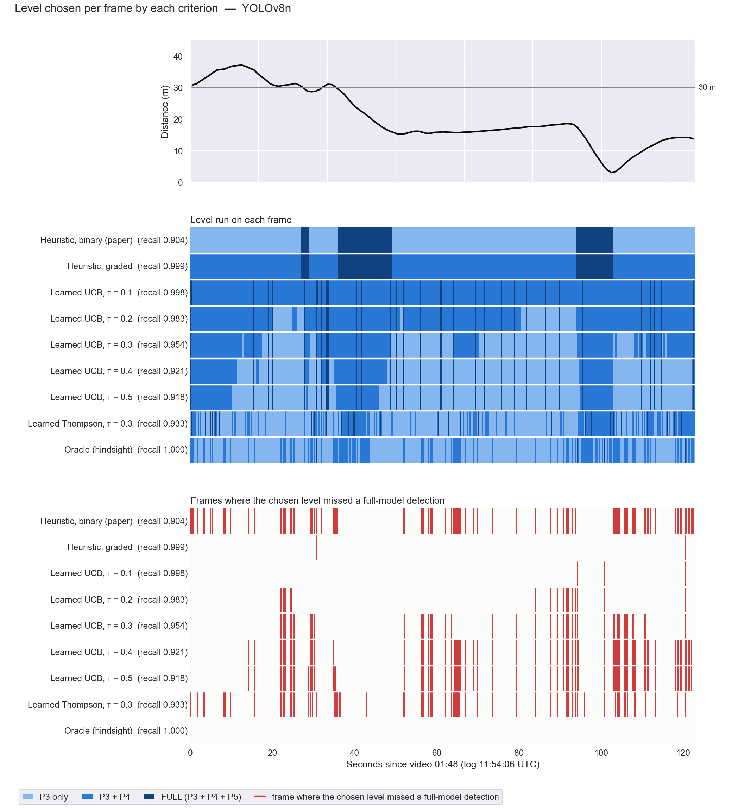
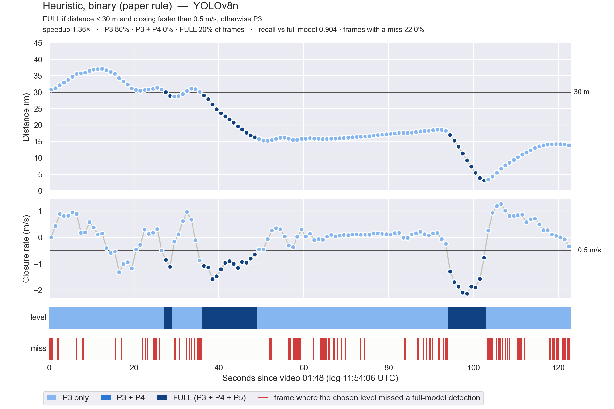
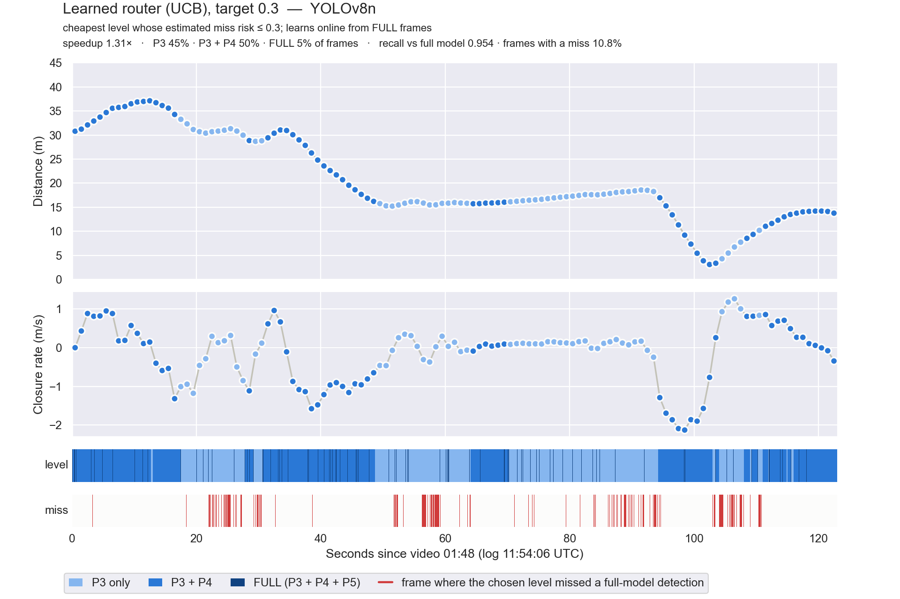
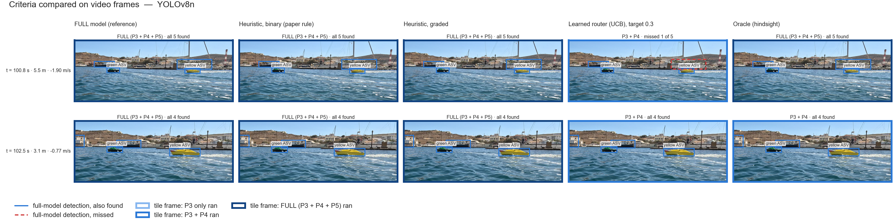
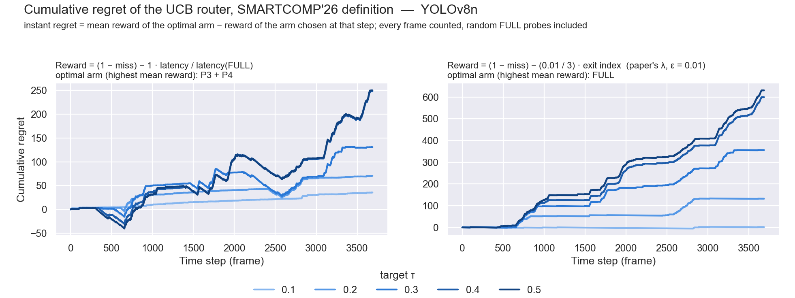

If this repository is useful to you, the following work can be cited:

```
@misc{papanikolaou2026trajectoryawareadaptiveinference,
      title={Trajectory-Aware Adaptive Inference in Object Detection Models},
      author={Grigorios Papanikolaou and Ioannis Kontopoulos and Giannis Spiliopoulos and Dimitris Zissis and Konstantinos Tserpes},
      year={2026},
      eprint={2605.16397},
      archivePrefix={arXiv},
      primaryClass={cs.CV},
      url={https://arxiv.org/abs/2605.16397},
}
```

# Trajectory-Aware Adaptive Inference in Object Detection Models

<div align="justify">Object detectors such as YOLOv8 predict objects at three scales through three detection heads
(P3, P4 and P5). Each head only depends on part of the network, so each head can serve as an implicit early exit:
running only the layers that P3 needs, or only those of P3 and P4, is cheaper than running the full model. This
repository contains the code for deciding <b>how much of the detector to run on each video frame using vessel
trajectories</b> (GPS/AIS positions) rather than the image itself, in the maritime setting of the MuseKDE workshop
of IEEE MDM 2026. In our recording, a camera ASV follows two moving ASVs. The distance and closure rate of the two
logged vessels act as a collision-risk signal: when they are close and converging, the full model is used;
otherwise a cheaper exit is used.</div>

<div align="justify">The repository contains both the code of the initial paper and an extension of it
(<code>adaptive_yolo/</code>), which adds a third exit level, a learned online router based on Upper Confidence
Bounds, an evaluation of every criterion against the full model, and measured speedups.</div>

## Repository structure

* `train/`: per-head learning-rate selection (`learning_rate.py`) and training of the YOLOv8 variants with a
  frozen backbone and per-component learning rates (`custom_train.py`).
* `trajectories/`: preprocessing of the ASV logs (time-window filtering and simultaneous, gap-free trajectories).
* `evaluation/`: per-head validation (`validate.py`), cutting the video window (`video_preprocessing.py`), and
  the original online-inference scripts (`track_base.py`, `crit_analysis.py`, `track_base_individual.py`).
* `models/`: the fine-tuned YOLOv8 n/s/m checkpoints of the paper and their per-head validation results.
* `adaptive_yolo/`: the extension (adaptive model, causal trajectory signal, heuristic and learned routers,
  evaluation, benchmark and seaborn plotting scripts). See [adaptive_yolo/README.md](adaptive_yolo/README.md).
* `results/`: outputs of the extended experiments. See
  [results/ground_level_0148-0351/README.md](results/ground_level_0148-0351/README.md).

## Initial results

<div align="justify">Each YOLOv8 scale was fine-tuned on a two-class dataset (ASV, Boat) with a frozen backbone and
a learning rate per head derived from the size distribution of the boxes (small 20.93% → P3, medium 50.79% → P4,
large 28.28% → P5). Every head was then evaluated on its own, as an early exit, on the validation split.</div>

<p>Per-head early exits (Tables II–III of the paper; <code>evaluation/validate.py</code>, accuracy and FLOPs also in
<code>models/*_lr.csv</code>). Speedup and FLOPs savings are relative to the full model and estimated by profiling
the subgraph of each head.</p>

| Model | Head | Speedup | FLOPs saved | mAP@50 | Precision | Recall |
|---|---|---:|---:|---:|---:|---:|
| YOLOv8n | P3 | 1.61× | 25.08% | 0.618 | 0.812 | 0.382 |
| | P4 | 1.45× | 33.79% | 0.796 | 0.896 | 0.646 |
| | P5 | 1.34× | 32.71% | 0.671 | 0.979 | 0.354 |
| YOLOv8s | P3 | 1.56× | 24.41% | 0.674 | 0.822 | 0.481 |
| | P4 | 1.53× | 28.54% | 0.808 | 0.898 | 0.665 |
| | P5 | 1.27× | 25.45% | 0.590 | 0.917 | 0.246 |
| YOLOv8m | P3 | 1.31× | 21.26% | 0.724 | 0.851 | 0.541 |
| | P4 | 1.33× | 20.56% | 0.871 | 0.935 | 0.763 |
| | P5 | 1.17× | 18.33% | 0.511 | 0.964 | 0.056 |

<div align="justify">Each head on its own is a conservative but reliable predictor: precision stays high while
recall drops, with P4 the strongest single head at every scale. In the trajectory experiment of the paper
(3,686 frames, 125 s), the rule <i>run the full model if the vessels are closer than 30 m and converging faster
than 0.5 m/s, otherwise P3</i> sent 659 frames to the full model and 3,027 to P3, reducing the projected
processing time from 37.22 s to 26.89 s (≈1.38×).</div>

## Extension

<div align="justify">The initial experiment showed how often each head is used and how much time is saved, but not
how much is lost. The extension asks: <b>on which frames does a cheaper exit miss something the full model would
have found, and can a router learn to avoid those frames?</b> To answer it:</div>

* **One adaptive model with three levels.** P3, P3+P4 and FULL share the same weights and the same decoding and
  NMS. The full level reproduces Ultralytics exactly. One full pass also yields the exact outputs of the cheaper
  levels, so every frame on which the full model runs shows what each level would have detected.
* **A causal trajectory signal.** Every frame uses only GPS data that would already be available live: one
  reading per second counted from the first record, last known position held for at most 2 s, backward-difference
  closure rate.
* **Criteria.** The paper's binary rule, a graded rule (P3+P4 below 60 m) and a **learned router**: two online
  Bayesian logistic models estimate the probability that P3 or P3+P4 misses a full-model detection given the
  trajectory, and the cheapest level whose risk is below a target τ is chosen. The risk is an Upper Confidence
  Bound (or a Thompson sample), the router learns only from frames on which the full model runs, and 5% of the
  frames are random full-model probes. This continues the UCB line of
  [MAB_UCB](https://github.com/gr3gor1/MAB_UCB), here applied to which heads to run in a detector.
* **Evaluation against the full model.** Recall of the full model's detections, share of frames with a miss,
  level shares, projected and measured speedup, a hindsight oracle as the upper bound, and the cumulative regret
  as defined in [arXiv:2604.24810](https://arxiv.org/abs/2604.24810). The bow of the camera ASV is always in view
  and is excluded from scoring.

## Criteria

<div align="justify">Every criterion makes one decision per video frame: which of the three levels to run.
<b>P3</b> runs layers 0–15 and the P3 head, <b>P3+P4</b> runs layers 0–18 and two heads, <b>FULL</b> runs the whole
network.</div>

### Shared input: the trajectory reading

1. **Frame → second.** The video is aligned to the log (video 01:48 = log 11:54:06 UTC), and every frame is
   assigned to the second of the log it falls in (29.97 frames share one reading).
2. **Second → positions.** The position of each logged ASV is the mean of its GPS fixes in that second. If an ASV
   has no fix, its last known position is held for at most 2 s; after that the second has no reading.
3. **Positions → signal.** The distance $d$ between the two ASVs is computed with the haversine formula, and the
   closure rate as $v_k = d_k - d_{k-1}$ (m/s, negative when the vessels converge, 0 in the first second).

A frame therefore receives either a reading $(d, v)$ or no reading. No criterion uses data from the future.

### Always P3 / always P3+P4 / always FULL

<div align="justify">Baselines that ignore the reading and always run the same level. Always FULL is the reference
(speedup 1×, recall 1). Always P3 is the fastest possible choice, and always P3+P4 shows the effect of dropping P5
alone.</div>

### Heuristic, binary (the paper rule)

1. No reading → FULL (fail-safe).
2. $d < 30$ m **and** $v < -0.5$ m/s (close and converging) → FULL.
3. Otherwise → P3.

<div align="justify">The rule has no memory and judges each frame on its own. Its blind spot is two vessels that are
close but not converging: the rule falls back to P3 even when a large vessel is in view.</div>

### Heuristic, graded

1. No reading → FULL.
2. $d < 30$ m and $v < -0.5$ m/s → FULL.
3. $d < 60$ m → P3+P4.
4. Otherwise → P3.

<div align="justify">In our window the vessels are never more than 37 m apart, so the graded rule effectively runs
FULL when the vessels are close and converging, and P3+P4 otherwise. A hysteresis option (<code>hold_frames</code>)
can keep a level for a minimum number of frames before stepping down; it was disabled in the experiments.</div>

### Learned router (UCB)

<div align="justify">

The learned router has no distance thresholds. It keeps two online Bayesian logistic
regressions, one for P3 and one for P3+P4, each estimating the probability that the level misses at least one
detection the full model would make, given the trajectory. Each model holds a mean weight vector $m$ (initially
0) and a per-weight precision $q$ (initially $1/\sigma_0^2$, i.e. very uncertain).

</div>

1. **Features.** The reading becomes seven features $x$: a bias, the proximity $10/(d+10)$, $\log(1+d)/5$,
   $\min(d, 300)/100$, the closure rate $v/5$, the approach speed $\max(-v, 0)/5$ and the urgency
   $1 - \mathrm{TTC}/120$, where $\mathrm{TTC} = d / \max(-v, 0)$ is the time to contact (capped at 120 s).
   No reading → FULL.
2. **Risk.** For each cheap level, an Upper Confidence Bound on the miss probability:
   $\text{risk} = \sigma\left(m^\top x + \beta \sqrt{\textstyle\sum_i x_i^2 / q_i}\right)$. The second term is one
   standard deviation of uncertainty ($\beta = 1$), so an untrained router is pessimistic and runs FULL.
3. **Probe.** With probability $\epsilon$ the frame runs FULL regardless of the risk, so that conditions the router
   stopped checking keep being labelled.
4. **Decision.** P3 if its risk ≤ τ, otherwise P3+P4 if its risk ≤ τ, otherwise FULL.
5. **Labels.** Only on FULL frames: one full pass contains the P3 and P4 outputs, so the router sees exactly what
   both cheaper levels would have found. The label of a level is 1 if it missed at least one full-model detection
   (confidence ≥ 0.25, same class, IoU ≥ 0.5, camera bow excluded), otherwise 0.
6. **Update.** For each cheap level, with label $y$: the precision relaxes towards the prior,
   $q \leftarrow q_0 + \gamma (q - q_0)$; then $p = \sigma(m^\top x)$, $q \leftarrow q + p(1-p)\,x^2$ and
   $m \leftarrow m + (y - p)\,x / q$ (Laplace update, as in Chapelle & Li, 2011).

<div align="justify">At the start of the window the router runs FULL and collects labels; as its uncertainty shrinks,
it moves to cheaper levels where misses are rare, and moves back when the scene changes. τ is the per-frame miss risk
accepted: the observed miss rate stays below τ, because the risk is pessimistic and FULL frames never miss.</div>

### Learned router (Thompson sampling)

<div align="justify">

Identical to the UCB router except for step 2: on every frame, a weight vector is sampled from
the posterior, $w \sim \mathcal{N}(m, 1/q)$, and the risk is $\sigma(w^\top x)$. The randomness explores cheaper
levels earlier, which makes the router less cautious than UCB at the same τ and makes it switch levels more
often.

</div>

### Oracle (hindsight)

<div align="justify">For every frame, the oracle compares the cached outputs of the three levels and picks the
cheapest level that misses nothing the full model found (P3, else P3+P4, else FULL). It ignores the trajectory and
needs the full model's output to decide, so it cannot be deployed; it gives the largest saving possible with zero
loss.</div>

## Extended results

<div align="justify">Window 01:48–03:51 of the recording (3,686 frames, log 11:54:06–11:56:09 UTC), newly
fine-tuned YOLOv8 n/s/m models. Recall is the share of full-model detections (confidence ≥ 0.25) also found by the
chosen level; miss is the share of frames on which the chosen level missed at least one of them.</div>

| Criterion | v8n recall | v8n miss | v8s recall | v8s miss | v8m recall | v8m miss |
|---|---:|---:|---:|---:|---:|---:|
| Always P3 | 0.854 | 33.8% | 0.864 | 32.9% | 0.922 | 17.4% |
| Always P3+P4 | 0.998 | 0.4% | 0.997 | 0.8% | 0.999 | 0.1% |
| Heuristic, binary (paper rule) | 0.904 | 22.0% | 0.902 | 23.4% | 0.945 | 12.2% |
| Heuristic, graded 30/60 m | 0.999 | 0.1% | 0.997 | 0.7% | 0.999 | 0.1% |
| Learned UCB, τ=0.1 | 0.998 | 0.4% | 0.997 | 0.7% | 0.999 | 0.3% |
| Learned UCB, τ=0.3 | 0.954 | 10.8% | 0.972 | 6.6% | 0.969 | 6.9% |
| Learned UCB, τ=0.4 | 0.921 | 17.9% | 0.935 | 15.4% | 0.957 | 9.6% |
| Learned UCB, τ=0.5 | 0.918 | 18.9% | 0.916 | 19.7% | 0.951 | 11.0% |
| Learned Thompson, τ=0.3 | 0.933 | 15.8% | 0.933 | 15.8% | 0.950 | 11.1% |
| Oracle (hindsight) | 1.000 | 0.0% | 1.000 | 0.0% | 1.000 | 0.0% |

<p>Speedup relative to always running the full model: projected from profiled forward latency / measured per frame
(pre-processing, forward pass, decoding and NMS) / measured end-to-end (including decoding the 4K video).</p>

| Criterion | YOLOv8n | YOLOv8s | YOLOv8m |
|---|---|---|---|
| Always P3 | 1.50 / 1.36 / 1.16× | 1.38 / 1.33 / 1.13× | 1.32 / 1.26 / 1.13× |
| Always P3+P4 | 1.21 / 1.15 / 1.07× | 1.16 / 1.15 / 1.07× | 1.16 / 1.13 / 1.07× |
| Heuristic, binary (paper rule) | 1.36 / 1.27 / 1.12× | 1.28 / 1.27 / 1.11× | 1.24 / 1.20 / 1.11× |
| Heuristic, graded 30/60 m | 1.16 / 1.12 / 1.06× | 1.12 / 1.13 / 1.06× | 1.13 / 1.11 / 1.06× |
| Learned UCB, τ=0.1 | 1.19 / 1.11 / 1.06× | 1.15 / 1.11 / 1.05× | 1.16 / 1.12 / 1.06× |
| Learned UCB, τ=0.3 | 1.31 / 1.20 / 1.09× | 1.20 / 1.15 / 1.07× | 1.24 / 1.18 / 1.09× |
| Learned UCB, τ=0.4 | 1.37 / 1.24 / 1.11× | 1.27 / 1.21 / 1.09× | 1.27 / 1.20 / 1.11× |
| Learned UCB, τ=0.5 | 1.38 / 1.25 / 1.11× | 1.30 / 1.23 / 1.10× | 1.28 / 1.21 / 1.11× |
| Learned Thompson, τ=0.3 | 1.35 / 1.23 / 1.11× | 1.27 / 1.20 / 1.09× | 1.27 / 1.20 / 1.11× |
| Oracle (hindsight) | 1.39 / 1.29 / 1.13× | 1.30 / 1.27 / 1.11× | 1.29 / 1.24 / 1.12× |

<p>Level chosen on each frame by every criterion (YOLOv8n), under the distance of the two logged ASVs, with the
frames on which the chosen level missed a full-model detection.</p>



<p>The paper's binary rule and the learned UCB router (τ = 0.3) on the distance and closure-rate signal
(YOLOv8n).</p>





<p>The criteria on frames showing both logged ASVs during the close approach (YOLOv8n). Blue: detections also found
by the chosen level, dashed red: missed.</p>



<p>Cumulative regret of the learned UCB router across time steps (YOLOv8n).</p>



## Conclusions

<div align="justify">

* **The initial result reproduces.** With the paper's rule, the projected speedup on YOLOv8n is 1.36×, close to the
  ≈1.38× of the paper.
* **The paper's rule costs more accuracy than its speedup suggests.** Measured against the full model, it misses a
  detection on 12–23% of the frames (recall 0.90–0.95). The typical failure is two vessels that are close but not
  converging: the rule falls back to P3, which can miss a large nearby vessel.
* **P5 is rarely needed in this scene.** Once the camera ASV's own bow is excluded, P3+P4 alone keeps 99.7–99.9% of
  the full model's detections at a measured 1.13–1.15×. Since the camera follows the two vessels, their apparent
  size stays roughly constant, and the full model is mostly needed for safety rather than for size.
* **The learned router dominates the paper's rule.** At similar projected speed, it misses less often at every
  scale: 17.9% vs 22.0% on YOLOv8n (τ = 0.4), 15.4% vs 23.4% on YOLOv8s (τ = 0.4) and 6.9% vs 12.2% on YOLOv8m
  (τ = 0.3). It needs no distance thresholds, τ directly sets the trade-off, and it discovers on its own that close
  vessels mean misses for the cheaper levels.
* **The trajectory is a risk signal, not a visibility signal.** The oracle reaches 1.29–1.39× without losing a single
  detection, which no trajectory-only criterion approaches. Most P3 misses come from other objects in the scene.
* **The router converges locally, not globally.** Under the regret definition of
  [arXiv:2604.24810](https://arxiv.org/abs/2604.24810), regret only stays flat for τ = 0.1. For larger τ it grows
  with the changes of the scene (marina passage, close approach), which a 123-second window from a cold start does
  not let it average out.
* **Projected speedups overstate the real gain.** Measured per frame, the gain is up to 0.13× lower than the
  projection. End-to-end it drops to 1.05–1.13×, because decoding a 4K frame costs about as much as the network
  itself. Decoding and resizing on the GPU would let more of the saving through.

</div>

<div align="justify">Limitations: a single 123-second recording; the full model, not ground-truth annotations, is
the reference for the extended results; and the two ASVs are identified by hull colour only for the frame figures.
Future work includes longer and more varied recordings, ASV-specific metrics, contextual bandits with image
features, and other architectures such as DETR.</div>

## Reproducing the extended results

```bash
# routing criteria (network once per frame, cached), per model
python -m adaptive_yolo.evaluate_routers --weights 8n.pt --source GROUND_LEVEL.MP4 --csv "ASV_logs (1).csv" \
    --sync 01:48=11:54:06 --start 01:48 --end 03:51 --own-vessel-bottom 0.97 \
    --targets 0.1 0.2 0.3 0.4 0.5 --out results/ground_level_0148-0351/8n
# measured speedups, tables, figures
python -m adaptive_yolo.benchmark results/ground_level_0148-0351 --model 8n --weights 8n.pt \
    --source GROUND_LEVEL.MP4 --own-vessel-bottom 0.97
python -m adaptive_yolo.aggregate results/ground_level_0148-0351
python -m adaptive_yolo.regret results/ground_level_0148-0351 --own-vessel-bottom 0.97
python -m adaptive_yolo.plot_regret results/ground_level_0148-0351
python -m adaptive_yolo.plot_signals results/ground_level_0148-0351
python -m adaptive_yolo.compare_frames results/ground_level_0148-0351 --model 8n --source GROUND_LEVEL.MP4 \
    --own-vessel-bottom 0.97 --both-asvs
```

The full list of commands is in [results/ground_level_0148-0351/README.md](results/ground_level_0148-0351/README.md).

Note: The extended experiments were run on a single NVIDIA GeForce RTX 4050 Laptop GPU.
